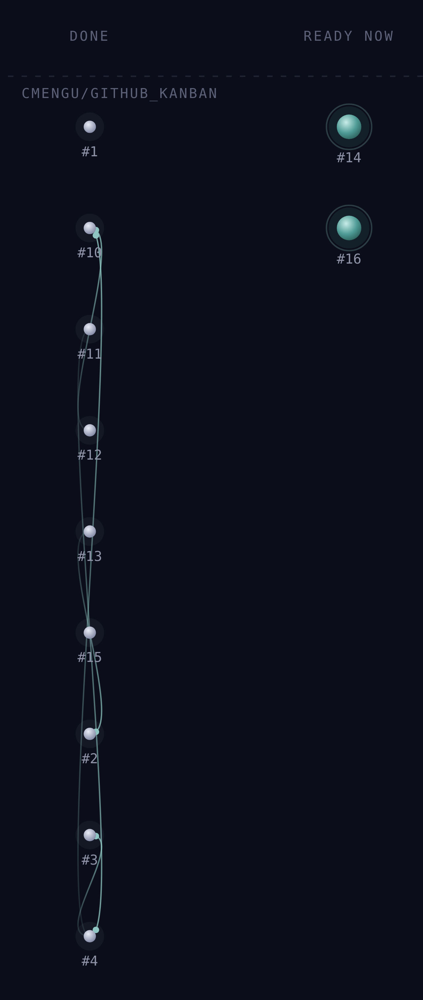

<h1 align="center">Overviewer</h1>

<p align="center">A web app that draws GitHub issues and pull requests from many repos as one dependency graph, grouped by workflow bucket.</p>

<p align="center">
  
</p>

<p align="center">Star map view on the demo data, a recorded snapshot of this repo's own issues (cropped to the dependency graph; the app labels this data "demo data"). The Board view groups the same tickets into Tickets, In progress, In review and Done columns.</p>

## Why

Kanban shows status and a graph shows structure, and GitHub renders issue dependencies as neither. Overviewer keeps the blocked-by edges visible while tickets move through the buckets, so you can see which open PR gates other tickets.

It is built for a loop where planning is done up front, AI agents implement tickets, and a human reviews.

## How it works

Nothing is stored. GitHub is the source of truth for tickets and blocked-by edges. A ticket's bucket is computed, not stored: closed is Done, an open linked PR is In review, an assignee is In progress, otherwise Tickets (`src/domain/derive.ts`, `bucketOf`). Layout is a hand-written function in `src/layout/layout.ts` that gives two views, board (column = bucket) and map (column = how many blockers away).

With no token the page shows the recorded snapshot in `src/fixtures/payloads/snapshot.json`. Paste a fine-grained token and a list of `owner/name` repos and it polls GitHub GraphQL every 45 seconds. The token is kept in `sessionStorage` for that tab only.

## Run it

```
npm install
npm run dev
npm test
```

## Prior art

The sweep in [docs/ticket-dag-viewer-landscape-2026-07-29.md](docs/ticket-dag-viewer-landscape-2026-07-29.md) found that GitHub exposes cross-repo issue dependencies through its API but does not draw them, that beads and its community viewers keep board and graph on separate tabs, and that Linear, Jira, ZenHub, Plane and Huly draw dependencies on timelines. API details are in [docs/github-api-facts-2026-08-01.md](docs/github-api-facts-2026-08-01.md).

## Status

Early. Spec and tickets live on the [issue tracker](https://github.com/cmengu/Github_Kanban/issues).
